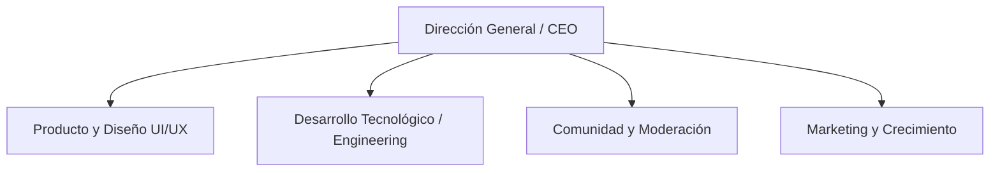

# 01 · Análisis y documentación inicial (RA1)

> **Plantilla.** Se entrega como **H1 el 26-nov-2026**. Cada apartado indica el criterio de evaluación (CE) que evidencia y qué se espera. Borra las notas en cursiva al rellenar.

## 1. Sector y empresas (CE 1a, 1b)

*Clasificación de empresas del sector*

| Empresas del sector | Características organizativas | servicio que ofrecen | 
|---|---|---|
| Pinterest | Empresa tecnológica global basada en descubrimiento visual y gestión masiva de contenidos mediante algoritmos de recomendación. |Plataforma web y móvil para descubrir, guardar y organizar ideas e imágenes visuales mediante tableros y pines.|
|Behance|Plataforma comunitaria global (perteneciente a Adobe) centrada en la exposición de portafolios detallados de diseño y arte profesional.|Espacio digital donde diseñadores e ilustradores muestran proyectos detallados y su proceso creativo para recibir feedback y visibilidad.|
|Dribble| Red social de networking y escaparate en creativos digitales con un modelo de contratación y empleo.|Publicación de micro-portafolios y muestras rápidas de diseño UI/UX, conectando talento directamente cib empresas que buscan contratar.|
|The desing blog|Publicación digital independiente comisariada por diseñadores para destacar trabajos del sector.|Blog de curación y contenido que muestra y reseña diariamente proyectos excepcionales de diseño gráfico, web y branding de todo el mundo.|
|Awwwards|Una de las referencias más conocidas para analizar diseño web de alto nivel. Reúne proyectos donde se combinan dirección de arte, interacción, contenido, animación y desarrollo front-end|Plataforma de concurso y premios (Site of the Day/Month) que analza y galardona las mejores webs combinando dirección de arte, interacción y desarrollo front-end.|

*Descripción detallada de una empresa tipo (Plataforma de portafolios e inspiración visual)*

- **Dirección General (CEO)**: Define la visión estratégica, la hoja de ruta del producto y la sostenibilidad económica de la plataforma.
- **Producto y Diseño UI/UX**: Diseña la experiencia de usuario, la arquitectura de información, las retículas visuales y el sistema de diseño de la interfaz.
- **Desarrollo Tecnológico (Engineering)**: Desarrolla y mantiene la aplicación web (front-end y back-end), las bases de datos, los motores de búsqueda y la infraestructura en la nube.
- **Comunidad y Moderación**: Supervisa la calidad de las publicaciones, gestiona las verificaciones de autoría, previene el plagio y da soporte a los creadores.
- **Marketing y Crecimiento**: Gestiona las alianzas con escuelas de diseño o estudios, las campañas de captación de talento y la comunicación de marca.

## 2. Necesidades y oportunidades (CE 1c, 1d)

**Lista priorizada de necesidades:**
- 1. Búsqueda precisa por paleta de colores y etiquetas técnicas (Prioridad: Alta): Los diseñadores e ilustradores necesitan filtrar referentes combinando estilos/herramientas con armonías cromáticas exactas, algo muy impreciso en plataformas generalistas. Criterio: Impacto directo en el flujo de trabajo diario del usuario. Fuente: Observación directa y análisis de interfaces en el Estado del Arte

- 2. Verificación de autoría original (Prioridad: Alta): En redes visuales masivas como Pinterest es habitual la resubida anónima de ilustraciones y diseños sin acreditar al creador. Se requiere un distintivo claro que proteja y dé visibilidad al autor real. Criterio: Necesidad crítica del colectivo creativo para proteger su portafolio. Fuente: Quejas recurrentes en comunidades de diseño y comparativa de plataformas.

- 3. Interfaz limpia, visual y equilibrada (Prioridad: Media): Se demanda una experiencia de navegación sin publicidad invasiva ni ruido comercial, pero manteniendo un diseño atractivo, moderno y visualmente estimulante (evitando interfaces excesivamente frías o puramente textuales). Criterio: Mejora de la experiencia de usuario (UX) y retención visual. Fuente: Análisis de usabilidad frente a redes saturadas de anuncios.
 
**Oportunidades de negocio:**
- Dato cuantitativo: Según los datos oficiales de Eurostat (Culture statistics - cultural employment), las industrias culturales y creativas en la Unión Europea emplean a más de 7,7 millones de personas (alrededor del 3,8 % del empleo total de la UE), destacando una alta proporción de trabajadores autónomos (freelance) y microempresas en disciplinas visuales que dependen de escaparates digitales para mostrar su trabajo y encontrar referentes.
- Fuente: Eurostat – Culture statistics (https://ec.europa.eu/eurostat/statistics-explained/index.php?title=Culture_statistics_-_cultural_employment).

## 3. Tipo de proyecto elegido (CE 1e)

**Proyecto elegido**: Una aplicación web interactiva de portafolios e inspiración visual enfocada en creativos, destacando por un buscador combinado de paletas de colores y etiquetas, y un sistema de verificación de autor original.

**¿Por qué frente a otras alternativas?**: Frente a crear un clon de Pinterest (donde el contenido carece de atribución y la búsqueda cromática es imprecisa) o desarrollar una red social masiva con funcionalidades inabarcables para una sola persona, este enfoque resuelve dos problemas reales del sector creativo con un alcance técnico realista, equilibrando el diseño de interfaz (UI/UX) y la programación en entorno cliente para llegar al hito de entrega con un producto sólido y funcional.

## 4. Requisitos y restricciones (CE 1f)

| ID | Requisito | Tipo (funcional / no funcional / restricción) | Cómo se verifica |
|---|---|---|---|
| RF-01 | El sistema debe permitir explorar un feed visual de proyectos en formato de retícula adaptable (masonry) | funcional | Comprobando visualmente que las tarjetas se adaptan al cambiar el tamaño de la ventana del navegador. |
| RF-02 | El usuario debe poder filtrar los proyectos combinando etiquetas temáticas y códigos o tonalidades de color de la paleta.| funcional | Introduciendo una etiqueta o seleccionando un color y verificando que la lista de resultados se actualiza correctamente en menos de 1 segundo |
| RF-03 | Cada publicación mostrará de forma visible el distintivo o insignia de "Autor verificado" para garantizar la autoría origina. | funcional | Comprobando que el perfil del creador cuenta con el ícono de validación en la vista de detalle de la obra.|
| RF-04 | El formulario de subida permitirá adjuntar imágenes, título, etiquetas y la paleta de colores asociada al proyecto| funcional | Rellenando el formulario de prueba y comprobando que el proyecto aparece publicado con sus datos corrector.|
| RNF-01 | La aplicación web debe cargar la página principal en menos de 3 segundos. | no funcional | Medición mediante las Herramientas de Desarrollador de Google Lighthouse.|
|RNF-02 | La interfaz debe ofrecer soporte adaptativo (responsive design) para dispositivos móviles, tablets y escritorios| no funcional | Pruebas manuales de redimensionado de pantalla y visualización en dispositivos reales o emulador.|
| REST-01 | El proyecto debe entregarse y desplegarse de manera funcional antes del 31 de marzo del 2026 | restricción | Verificando la fecha de entrega y el enlace de despliegue activo en Vercel/Netlify |
|REST-2 | El desarrollo debe realizarse utilizando control de versiones con Git y flujos de trabajo mediante Pull Request| restricción | Comprobando el historial de commits y los PRs aprobados en el repositorio de GitHub.|

### Matriz de trazabilidad

| Objetivo | Requisito | Caso de uso | Pantalla o endpoint | Prueba o indicador |
|---|---|---|---|---|
| OBJ-01 Facilitar la búsqueda visual de proyectos | RF-01 | CU-01 Explorar feed | Pantalla principal | pendiente |
| OBJ-01 Facilitar la búsqueda visual de proyectos | RF-02 | CU-02 Filtrar por color/etiquetas | Panel de filtros | pendiente |
| OBJ-02 Garantizar la autoría del contenido | RF-03 | CU-03 Ver detalle de obra | Vista de detalle de proyecto | pendiente |
| OBJ-03 Permitir la publicación de obras | RF-04 | CU-04 Subir proyecto | Formulario de publicación | pendiente |
| OBJ-04 Garantizar calidad y rendimiento web | RNF-01 | Proceso global de carga | Toda la aplicación| pendiente |
| OBJ-04 Garantizar calidad y rendimiento web | RNF-02 | Adaptabilidad visual | Todas las vistas (Responsive)| pendiente |
## 5. Obligaciones fiscales, laborales y de prevención (CE 1g)

- **Ámbito fiscal**: Como el proyecto se plantea en una primera fase como prototipo académico y sin ánimo de lucro, no requiere alta censal inmediata en el Impuesto de Actividades Económicas (IAE) ni obligaciones de IVA, las cuales aplicarían únicamente en caso de comercialización futura como autónomo o sociedad (Ley 37/1992 del IVA).

- **Ámbito laboral**: Si el proyecto evolucionase a empresa, se regiría por el Estatuto de los Trabajadores (Real Decreto Legislativo 2/2015) y el convenio colectivo correspondiente a empresas de consultoría y tecnologías de la información.

- **Prevención de riesgos laborales**: Cumplimiento de la Ley 31/1995 de Prevención de Riesgos Laborales, aplicando ergonomía informática y pausas recomendadas en puestos de trabajo de oficina con pantallas de visualización de datos (PVD).

## 6. Ayudas y subvenciones (CE 1h)

- Ayuda: Programa Kit Digital (financiado por la Unión Europea – Next Generation EU, gestionado por Red.es) / Subvenciones autonómicas al emprendimiento innovador (como las líneas del Instituto de Desarrollo Económico del Principado de Asturias - Sekuens, o equivalentes locales).

- Requisitos: En caso de constituirse como autónomo o microempresa para explotar la plataforma, estar dado de alta en el censo de empresarios, hallarse al corriente de las obligaciones tributarias y con la Seguridad Social, y no superar el límite de ayudas de minimis.

- Plazo: Convocatorias abiertas de forma continua o periódica según publicación en el BOE / Boletín Oficial autonómico correspondiente durante el ejercicio vigente.

## 7. Guion de trabajo (CE 1i)

El proyecto se desarrolla de manera individual (Responsable: Stephany Díaz) siguiendo una planificación iterativa gestionada mediante el tablero de GitHub Projects:

- Hito 1 (Entrega: 26-nov-2026) — Análisis y Estado del Arte: Definición del problema, estudio de mercado (01b-sota.md), análisis de requisitos y documentación inicial (01-analisis.md).

- Hito 2 — Diseño UI/UX y Arquitectura: Creación de wireframes, guía de estilos (tipografía, paleta) y prototipo interactivo de las pantallas principales en Figma.

- Hito 3 — Desarrollo del MVP (Versión Mínima): Maquetación responsive con HTML5 y Tailwind CSS, implementación de la retícula masonry, filtros por etiqueta/color y carga dinámica de datos.

- Hito 4 (Entrega límite: 31-mar-2026) — Pruebas y Despliegue: Verificación de todos los requisitos (Lighthouse, responsive), corrección de errores y despliegue en producción en Vercel/Netlify.

## 8. Glosario

| Término | Definición | Sinónimos que NO uso |
|---|---|---|
| Retícula Masonry | Disposición visual en cuadrícula donde las tarjetas se organizan en columnas adaptándose a la altura variable de cada imagen sin dejar huecos vacíos. | Mosaico desordenado, rejilla flotante, puzle de fotos |
| Paleta cromática | Conjunto de colores principales extraídos o asociados a un proyecto gráfico que definen su armonía visual. | Gama de tintes, espectro de colores |
| Pull Request | Petición formal dentro de GitHub para revisar e integrar los cambios de una rama de desarrollo hacia la rama principal (main). | Subida directa, fusión de archivos, actualización de rama |
| Wireframe | Esquema visual básico de baja o media fidelidad que muestra la estructura de una página web sin entrar en detalles de diseño estético. | Boceto feo, plano estructural, mapa de grises |

---

## Criterios de evaluación de este documento (RA1, texto literal)

- **1a)** Se han clasificado las empresas del sector por sus características organizativas y el tipo de producto o servicio que ofrecen.
- **1b)** Se han caracterizado las empresas tipo indicando la estructura organizativa y las funciones de cada departamento.
- **1c)** Se han identificado las necesidades más demandadas a las empresas.
- **1d)** Se han valorado las oportunidades de negocio previsibles en el sector.
- **1e)** Se ha identificado el tipo de proyecto requerido para dar respuesta a las demandas previstas.
- **1f)** Se han determinado las características específicas requeridas al proyecto.
- **1g)** Se han determinado las obligaciones fiscales, laborales y de prevención de riesgos y sus condiciones de aplicación.
- **1h)** Se han identificado posibles ayudas o subvenciones para la incorporación de nuevas tecnologías de producción o de servicio que se proponen.
- **1i)** Se ha elaborado el guión de trabajo que se va a seguir para la elaboración del proyecto.
