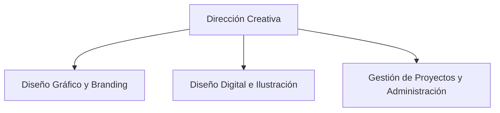

# 01 · Análisis y documentación inicial (RA1)

> **Plantilla.** Se entrega como **H1 el 26-nov-2026**. Cada apartado indica el criterio de evaluación (CE) que evidencia y qué se espera. Borra las notas en cursiva al rellenar.

## 1. Sector y empresas del sector (CE 1a, 1b)

### Delimitación del sector y código CNAE
* **Sector:** Actividades de diseño especializado (diseño gráfico, identidad visual, ilustración y dirección de arte). Es el sector de los profesionales y estudios creativos a los que ayuda la plataforma **Kreato**.
* **Código CNAE (2025)**: 74.11 (Diseño gráfico y servicios de diseño especializado) — (Sustituye al antiguo 7410 del CNAE 2009).

### Clasificación de empresas del sector
| Empresa | Tamaño | Forma jurídica | Ámbito | Servicio | Fuente y fecha | Estado |
|---|---|---|---|---|---|---|
| **Mucho** | Mediana (~30-40 personas) | S. L. | Internacional (sedes en Barcelona, París, San Francisco) | Consultoría de diseño gráfico, identidad corporativa y estrategia de marca. | https://wearemuch.com (acceso 19-11-2026) | `leído` |
| **Estudio Pep Carrió** | Microempresa (1-5 personas) | Autónomo / Estudio | Nacional (Madrid) | Diseño gráfico editorial, cartelería, identidad visual e ilustración. | https://pepcarrio.com (acceso 19-11-2026) | `leído` |
| **Folch Studio** | Pequeña (~15-25 personas) | S. L. | Internacional (Barcelona) | Agencia creativa, dirección de arte, narrativa visual y diseño digital. | https://folchstudio.com (acceso 19-11-2026) | `leído` |
| **Erretres** | Pequeña (~20-30 personas) | S. L. | Nacional / Internacional (Madrid) | Consultoría de diseño estratégico, branding y experiencia digital. | https://erretres.com (acceso 19-11-2026) | `leído` |
| **Summa Branding** | Mediana (~40-50 personas) | S. L. | Nacional / Internacional (Madrid y Barcelona) | Creación, gestión y transformación de marcas y diseño de experiencias. | https://summa.es (acceso 19-11-2026) | `leído` |

### Agrupación de empresas
* **Estudios boutique / Microempresas creativas:** *Estudio Pep Carrió* (equipos muy reducidos, trato directo con el cliente y enfoque artesanal en branding e ilustración).
* **Agencias de diseño de tamaño pequeño-mediano:** *Folch Studio* y *Erretres* (equipos multidisciplinares que combinan diseño gráfico con estrategia y entornos digitales).
* **Consultoras medianas / grandes de branding:** *Mucho* y *Summa Branding* (estructuras con varias sedes y proyectos corporativos de gran escala).

### Empresa tipo y estructura
* **Empresa tipo elegida:** **Estudio Pep Carrió** (dentro del grupo de *Estudios boutique / Microempresas creativas*).
* **Por qué:** Porque representa el perfil exacto del usuario principal de **Kreato**: un estudio pequeño de diseño gráfico e ilustración que necesita encontrar inspiración cromática rápidamente y mostrar su portafolio con autoría verificada para captar clientes.

***Funciones de cada departamento:***

- **Dirección Creativa:** Define el concepto visual de cada encargo, supervisa la calidad estética y se comunica directamente con los clientes y el resto de departamentos.
- **Diseño Gráfico y Branding:** Desarrolla las identidades visuales, tipografías, paletas de colores y materiales impresos, coordinándose con el área digital para mantener la coherencia.
- **Diseño Digital e Ilustración:** Crea ilustraciones personalizadas, interfaces web y activos visuales, apoyándose en Dirección Creativa para validar el estilo.
- **Gestión de Proyectos y Administración:** Controla los presupuestos, plazos de entrega, facturación y relación con proveedores externos.

## 2. Necesidades del sector y oportunidad de mercado (CE 1c, 1d)

### Problema principal
Los diseñadores gráficos, ilustradores y creadores visuales sufren la pérdida de atribución de autoría en internet y tienen dificultades para encontrar inspiración visual organizada por gamas cromáticas y procesos creativos reales (bocetos y fases de trabajo), ya que las plataformas actuales priorizan el contenido masivo sin proteger al autor original.

### Necesidades priorizadas del sector
*Criterio de ordenación:* Se priorizan aquellas necesidades que son mencionadas por un mayor número de soluciones analizadas en el Estado del Arte y cuyo déficit genera una mayor pérdida de tiempo o valor para el creador.

| Prioridad | Necesidad | Fuente | Por qué ocupa este puesto |
|---|---|---|---|
| **1** | Búsqueda y filtrado visual avanzado por paletas de color y etiquetas | Soluciones SOTA (Coolors, Pinterest) | Es la herramienta principal que demandan los creativos para agilizar sus procesos de diseño conceptual. |
| **2** | Protección y verificación estricta de la autoría original de las obras | Reseñas de creadores / Foros de diseño | Evita el plagio y la pérdida de atribución, una de las mayores quejas en redes visuales masivas. |
| **3** | Desglose visible del proceso creativo (bocetos, paletas y resultado final) | Análisis de portafolios (Behance, Dribbble) | Permite entender el flujo de trabajo real del autor, algo que los portafolios estáticos tradicionales no muestran de forma integrada. |
| **4** | Espacio de comunidad y visualización limpia sin saturación publicitaria | Quejas públicas sobre plataformas masivas | Mejora la experiencia de inspiración frente a entornos altamente mercantilizados y repletos de anuncios. |

### Dato cuantitativo y análisis de oportunidad
* **Dato de mercado:** Según las estadísticas culturales de **Eurostat** sobre empleo en el sector creativo y cultural, Europa cuenta con más de **7,7 millones de profesionales** dedicados a actividades creativas y de diseño, un sector altamente digitalizado pero fragmentado en cuanto a herramientas de inspiración independientes (Fuente: *Eurostat - Culture statistics*, acceso 19-11-2026, https://ec.europa.eu/eurostat).
* **Valoración de la oportunidad:** Existe una demanda clara y desatendida por parte de estudios independientes e ilustradores que buscan una plataforma propia donde inspirarse y mostrar su proceso sin quedar sepultados por los algoritmos publicitarios de las grandes redes generalistas.

---

## 3. Tipo de proyecto elegido y alternativas (CE 1e)

Para dar respuesta a las necesidades del sector, se han valorado tres posibles alternativas técnicas antes de tomar la decisión definitiva:

| Opción de proyecto | Coste | Tiempo estimado | Encaje con mis conocimientos (Ciclo DAW) |
|---|---|---|---|
| **Aplicación web a medida (Frontend interactivo con feed y filtros)** | Medio | Medio / Alto | Alto ( HTML5, Tailwind CSS y JavaScript ES6+ adaptados a los contenidos del ciclo). |
| **Adaptar un gestor de contenidos existente (WordPress / CMS)** | Bajo | Bajo | Medio (implica lidiar con plugins pesados y limitaciones de diseño personalizado). |
| **Desarrollo de aplicación móvil nativa** | Alto | Muy alto | Bajo (excede el ámbito web principal del ciclo formativo y requiere entornos específicos). |

* **Justificación de la elección:** Se elige desarrollar una **aplicación web a medida (Kreato)**. Se desarta adaptar un CMS tradicional porque limita el control estricto sobre el diseño visual y el sistema de filtrado cromático personalizado, y se descarta la app móvil nativa porque el alcance y los plazos temporales del ciclo formativo están orientados al entorno web.

## 4. Requisitos y restricciones (CE 1f)

| ID | Requisito | Tipo (funcional / no funcional / restricción) | Cómo se verifica |
|---|---|---|---|
| RF-01 | El sistema debe permitir explorar un feed visual de proyectos en formato de retícula adaptable (masonry) | funcional | Comprobando visualmente que las tarjetas se adaptan al cambiar el tamaño de la ventana del navegador. |
| RF-02 | El usuario debe poder filtrar los proyectos combinando etiquetas temáticas y códigos o tonalidades de color de la paleta.| funcional | Introduciendo una etiqueta o seleccionando un color y verificando que la lista de resultados se actualiza correctamente en menos de 1 segundo |
| RF-03 | Cada publicación mostrará de forma visible el distintivo o insignia de "Autor verificado" para garantizar la autoría origina. | funcional | Comprobando que el perfil del creador cuenta con el ícono de validación en la vista de detalle de la obra.|
| RF-04 | El formulario de subida permitirá adjuntar imágenes, título, etiquetas y la paleta de colores asociada al proyecto| funcional | Rellenando el formulario de prueba y comprobando que el proyecto aparece publicado con sus datos corrector.|
| RNF-01 | La aplicación web debe cargar la página principal en menos de 3 segundos. | no funcional | Medición mediante las Herramientas de Desarrollador de Google Lighthouse.|
|RNF-02 | La interfaz debe ofrecer soporte adaptativo (responsive design) para dispositivos móviles, tablets y escritorios| no funcional | Pruebas manuales de redimensionado de pantalla y visualización en dispositivos reales o emulador.|
| REST-01 | El proyecto debe entregarse y desplegarse de manera funcional antes del 31 de marzo del 2026 | restricción | Verificando la fecha de entrega y el enlace de despliegue activo en Vercel/Netlify |
|REST-2 | El desarrollo debe realizarse utilizando control de versiones con Git y flujos de trabajo mediante Pull Request| restricción | Comprobando el historial de commits y los PRs aprobados en el repositorio de GitHub.|

### Matriz de trazabilidad

| Objetivo | Requisito | Caso de uso | Pantalla o endpoint | Prueba o indicador |
|---|---|---|---|---|
| OBJ-01 Facilitar la búsqueda visual de proyectos | RF-01 | CU-01 Explorar feed | Pantalla principal | pendiente |
| OBJ-01 Facilitar la búsqueda visual de proyectos | RF-02 | CU-02 Filtrar por color/etiquetas | Panel de filtros | pendiente |
| OBJ-02 Garantizar la autoría del contenido | RF-03 | CU-03 Ver detalle de obra | Vista de detalle de proyecto | pendiente |
| OBJ-03 Permitir la publicación de obras | RF-04 | CU-04 Subir proyecto | Formulario de publicación | pendiente |
| OBJ-04 Garantizar calidad y rendimiento web | RNF-01 | Proceso global de carga | Toda la aplicación| pendiente |
| OBJ-04 Garantizar calidad y rendimiento web | RNF-02 | Adaptabilidad visual | Todas las vistas (Responsive)| pendiente |
## 5. Obligaciones fiscales, laborales y de prevención (CE 1g)

- **Ámbito fiscal**: Como el proyecto se plantea en una primera fase como prototipo académico y sin ánimo de lucro, no requiere alta censal inmediata en el Impuesto de Actividades Económicas (IAE) ni obligaciones de IVA, las cuales aplicarían únicamente en caso de comercialización futura como autónomo o sociedad (Ley 37/1992 del IVA).

- **Ámbito laboral**: Si el proyecto evolucionase a empresa, se regiría por el Estatuto de los Trabajadores (Real Decreto Legislativo 2/2015) y el convenio colectivo correspondiente a empresas de consultoría y tecnologías de la información.

- **Prevención de riesgos laborales**: Cumplimiento de la Ley 31/1995 de Prevención de Riesgos Laborales, aplicando ergonomía informática y pausas recomendadas en puestos de trabajo de oficina con pantallas de visualización de datos (PVD).

## 6. Ayudas y subvenciones (CE 1h)

- Ayuda: Programa Kit Digital (financiado por la Unión Europea – Next Generation EU, gestionado por Red.es) / Subvenciones autonómicas al emprendimiento innovador (como las líneas del Instituto de Desarrollo Económico del Principado de Asturias - Sekuens, o equivalentes locales).

- Requisitos: En caso de constituirse como autónomo o microempresa para explotar la plataforma, estar dado de alta en el censo de empresarios, hallarse al corriente de las obligaciones tributarias y con la Seguridad Social, y no superar el límite de ayudas de minimis.

- Plazo: Convocatorias abiertas de forma continua o periódica según publicación en el BOE / Boletín Oficial autonómico correspondiente durante el ejercicio vigente.

## 7. Guion de trabajo (CE 1i)

El proyecto se desarrolla de manera individual (Responsable: Stephany Díaz) siguiendo una planificación iterativa gestionada mediante el tablero de GitHub Projects:

- Hito 1 (Entrega: 26-nov-2026) — Análisis y Estado del Arte: Definición del problema, estudio de mercado (01b-sota.md), análisis de requisitos y documentación inicial (01-analisis.md).

- Hito 2 — Diseño UI/UX y Arquitectura: Creación de wireframes, guía de estilos (tipografía, paleta) y prototipo interactivo de las pantallas principales en Figma.

- Hito 3 — Desarrollo del MVP (Versión Mínima): Maquetación responsive con HTML5 y Tailwind CSS, implementación de la retícula masonry, filtros por etiqueta/color y carga dinámica de datos.

- Hito 4 (Entrega límite: 31-mar-2026) — Pruebas y Despliegue: Verificación de todos los requisitos (Lighthouse, responsive), corrección de errores y despliegue en producción en Vercel/Netlify.

## 8. Glosario

| Término | Definición | Sinónimos que NO uso |
|---|---|---|
| Retícula Masonry | Disposición visual en cuadrícula donde las tarjetas se organizan en columnas adaptándose a la altura variable de cada imagen sin dejar huecos vacíos. | Mosaico desordenado, rejilla flotante, puzle de fotos |
| Paleta cromática | Conjunto de colores principales extraídos o asociados a un proyecto gráfico que definen su armonía visual. | Gama de tintes, espectro de colores |
| Pull Request | Petición formal dentro de GitHub para revisar e integrar los cambios de una rama de desarrollo hacia la rama principal (main). | Subida directa, fusión de archivos, actualización de rama |
| Wireframe | Esquema visual básico de baja o media fidelidad que muestra la estructura de una página web sin entrar en detalles de diseño estético. | Boceto feo, plano estructural, mapa de grises |

---

## Criterios de evaluación de este documento (RA1, texto literal)

- **1a)** Se han clasificado las empresas del sector por sus características organizativas y el tipo de producto o servicio que ofrecen.
- **1b)** Se han caracterizado las empresas tipo indicando la estructura organizativa y las funciones de cada departamento.
- **1c)** Se han identificado las necesidades más demandadas a las empresas.
- **1d)** Se han valorado las oportunidades de negocio previsibles en el sector.
- **1e)** Se ha identificado el tipo de proyecto requerido para dar respuesta a las demandas previstas.
- **1f)** Se han determinado las características específicas requeridas al proyecto.
- **1g)** Se han determinado las obligaciones fiscales, laborales y de prevención de riesgos y sus condiciones de aplicación.
- **1h)** Se han identificado posibles ayudas o subvenciones para la incorporación de nuevas tecnologías de producción o de servicio que se proponen.
- **1i)** Se ha elaborado el guión de trabajo que se va a seguir para la elaboración del proyecto.
